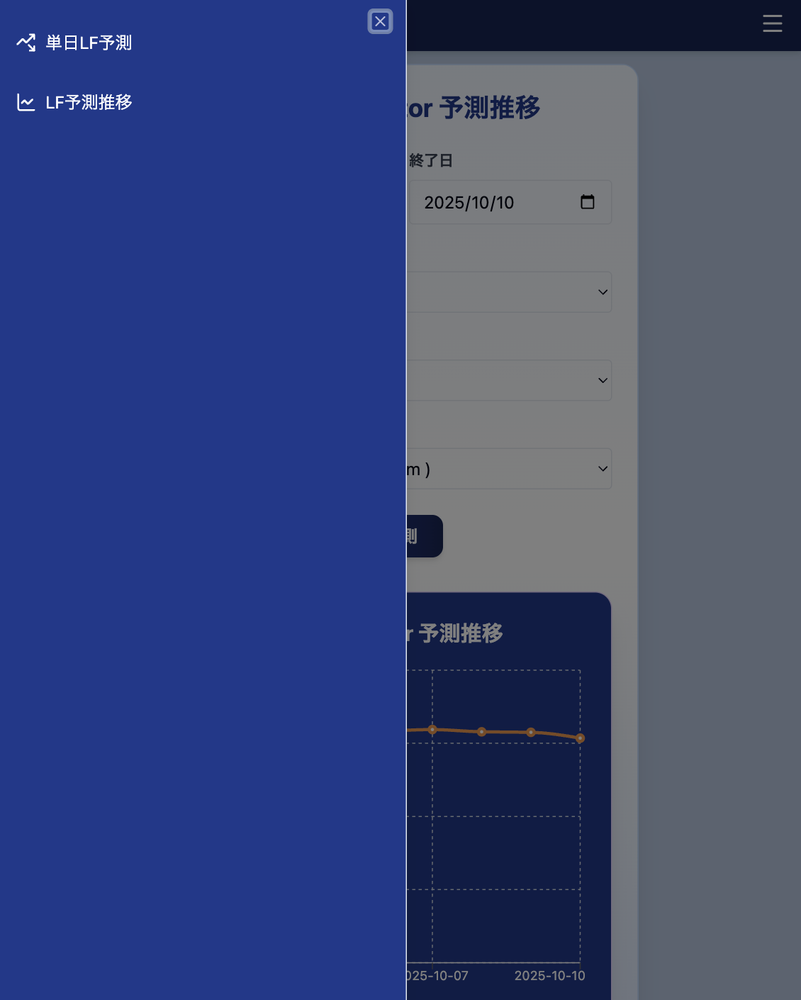
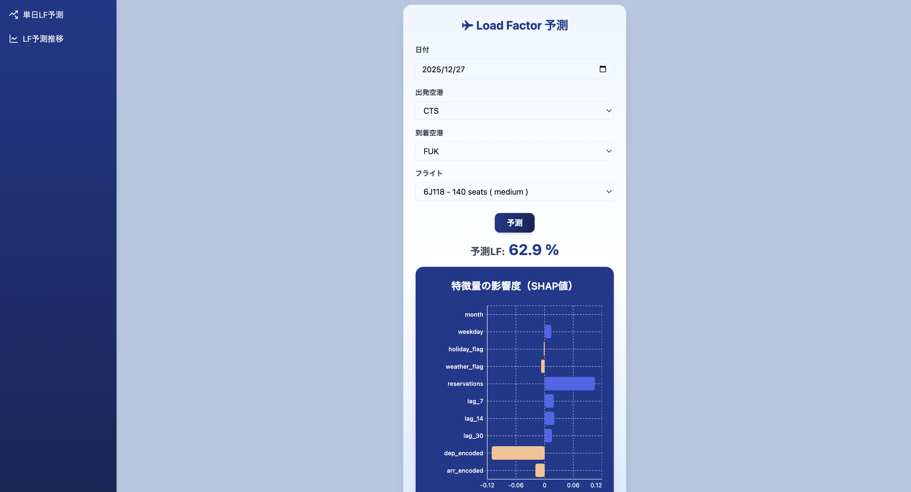
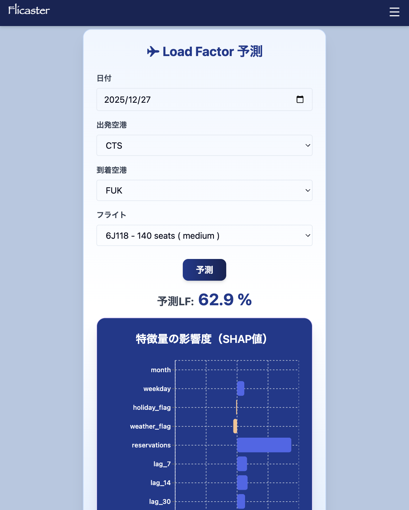
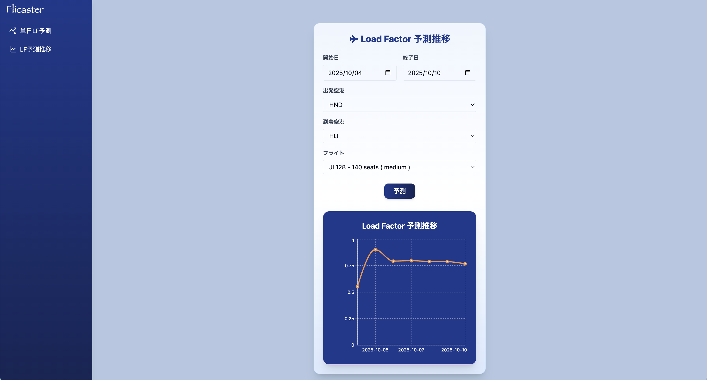
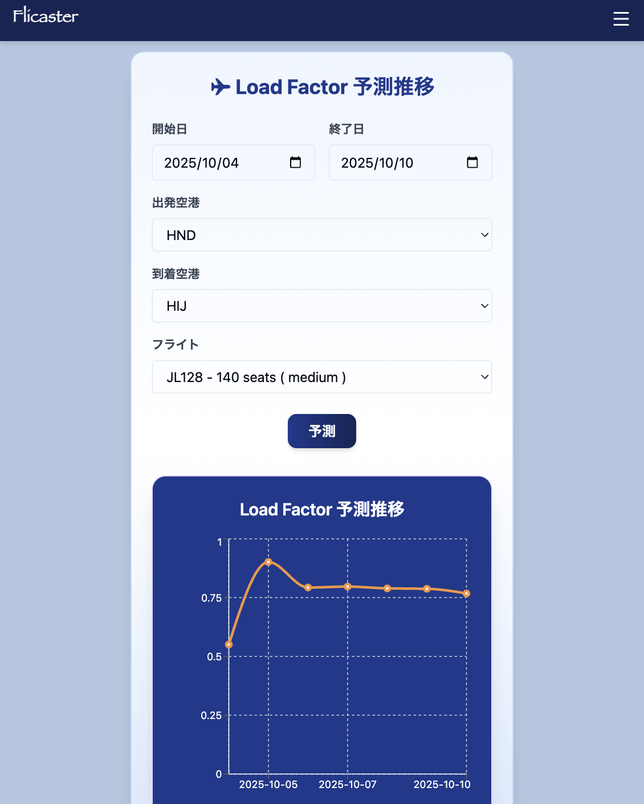

# Flicaster

XGBoost を用いた航空需要予測のデモアプリケーション

## システム概要

Flicaster は、機械学習（XGBoost）を利用して航空便の搭乗率（Load Factor）を予測する Web アプリケーションです。過去の運航データや予約状況、天候情報などを基に、特定の便・日付における搭乗率を予測します。また、SHAP（SHapley Additive exPlanations）による予測根拠の可視化も提供します。

### 主な特徴

- **単日予測**: 指定した日付・便の搭乗率を予測
- **期間予測**: 指定期間における搭乗率の推移を予測
- **予測根拠の可視化**: SHAP 値による各特徴量の寄与度表示
- **レスポンシブデザイン**: デスクトップ・モバイル対応

### サイドメニュー（モバイル）



### 単日 LF 予測画面

<div>
  
  
</div>

#### デモ GIF

<p align="left">
  
</p>

### LF 予測推移画面

<div>
  
  
</div>

#### デモ GIF

<p align="left">
  
</p>

## 機能説明

### 1. 単日搭乗率予測

- 出発空港・到着空港・便名・日付を選択
- 選択した条件での搭乗率を予測
- SHAP 値による特徴量の寄与度をバーチャートで表示

### 2. 搭乗率推移予測

- 期間（開始日〜終了日）を指定して複数日の予測を実行
- 時系列チャートで搭乗率の推移を可視化
- 各日付の予測値と SHAP 値を取得

### 3. 空港・便情報管理

- 空港マスタ（コード、名称、地域、規模、座標）
- 便マスタ（便名、出発/到着空港、航空会社、距離、座席数）

## アーキテクチャ

```
┌─────────────────┐    ┌─────────────────┐    ┌─────────────────┐
│   Frontend      │    │    Backend      │    │    Database     │
│   (Next.js)     │◄──►│   (FastAPI)     │◄──►│    (MySQL)      │
│                 │    │                 │    │                 │
│ - React         │    │ - XGBoost       │    │ - 空港マスタ    │
│ - TypeScript    │    │ - SHAP          │    │ - 便マスタ      │
│ - Tailwind CSS  │    │ - SQLAlchemy    │    │ - 運航履歴      │
│ - Recharts      │    │ - Pandas        │    │ - 予測条件      │
└─────────────────┘    └─────────────────┘    └─────────────────┘
```

### データフロー

1. フロントエンドで予測条件を入力
2. バックエンド API に予測リクエストを送信
3. データベースから関連データを取得
4. XGBoost モデルで搭乗率を予測
5. SHAP 値で予測根拠を計算
6. 結果をフロントエンドに返却・可視化

## 技術スタック

### フロントエンド

- **フレームワーク**: Next.js 15.5.3
- **言語**: TypeScript 5.x
- **UI ライブラリ**: React 19.1.0
- **スタイリング**: Tailwind CSS 4.x
- **チャートライブラリ**: Recharts 3.2.1
- **UI コンポーネント**: Radix UI, Lucide React

### バックエンド

- **フレームワーク**: FastAPI
- **言語**: Python 3.11
- **機械学習**: XGBoost, SHAP
- **データ処理**: Pandas, NumPy
- **ORM**: SQLAlchemy
- **データベースドライバー**: PyMySQL
- **その他**: jpholiday（祝日判定）

### データベース

- **RDBMS**: MySQL 8.0

### インフラ

- **コンテナ**: Docker, Docker Compose
- **Web サーバー**: Uvicorn

## ディレクトリ構成

```
flicaster/
├── backend/                    # バックエンドアプリケーション
│   ├── app/
│   │   ├── data/              # CSVデータファイル
│   │   │   ├── airport_master.csv
│   │   │   ├── flight_master.csv
│   │   │   ├── flight_history.csv
│   │   │   └── flight_condition.csv
│   │   ├── models/            # 学習済みモデル
│   │   │   ├── load_factor_model.pkl
│   │   │   └── passenger_model.pkl
│   │   ├── routers/           # APIルーター
│   │   │   ├── airports.py
│   │   │   ├── flights.py
│   │   │   ├── predict_load_factor.py
│   │   │   └── predict_load_factor_range_from_db.py
│   │   ├── scripts/           # データ生成・モデル学習スクリプト
│   │   │   ├── generate_*.py
│   │   │   └── train_load_factor_model.py
│   │   ├── db.py             # データベース設定
│   │   ├── models.py         # SQLAlchemyモデル
│   │   ├── schemas.py        # Pydanticスキーマ
│   │   ├── main.py           # FastAPIアプリケーション
│   │   └── load_data.py      # データ投入スクリプト
│   ├── Dockerfile
│   └── requirements.txt
├── frontend/                   # フロントエンドアプリケーション
│   ├── src/
│   │   ├── app/
│   │   │   ├── components/    # Reactコンポーネント
│   │   │   ├── predict/       # 単日予測ページ
│   │   │   ├── trend/         # 推移予測ページ
│   │   │   └── layout.tsx
│   │   └── lib/
│   │       └── api.ts         # API通信ライブラリ
│   ├── Dockerfile
│   └── package.json
├── docs/                      # ドキュメント・画像
├── docker-compose.yml         # Docker Compose設定
├── .env                       # 環境変数
└── README.md
```

## データベース・テーブル構成

### airports（空港マスタ）

| カラム名 | 型           | 説明                 |
| -------- | ------------ | -------------------- |
| code     | VARCHAR(10)  | 空港コード（主キー） |
| name     | VARCHAR(100) | 空港名               |
| region   | VARCHAR(50)  | 地域                 |
| scale    | VARCHAR(50)  | 規模（hub/regional） |
| lat      | FLOAT        | 緯度                 |
| lon      | FLOAT        | 経度                 |

### flights（便マスタ）

| カラム名      | 型          | 説明                              |
| ------------- | ----------- | --------------------------------- |
| flight_no     | VARCHAR(20) | 便名（主キー）                    |
| departure     | VARCHAR(10) | 出発空港コード                    |
| arrival       | VARCHAR(10) | 到着空港コード                    |
| airline_code  | VARCHAR(10) | 航空会社コード                    |
| distance_km   | FLOAT       | 距離（km）                        |
| distance_cat  | VARCHAR(20) | 距離カテゴリ（short/medium/long） |
| seat_capacity | INTEGER     | 座席数                            |

### flight_histories（運航履歴）

| カラム名      | 型          | 説明                |
| ------------- | ----------- | ------------------- |
| id            | INTEGER     | ID（主キー）        |
| flight_no     | VARCHAR(20) | 便名                |
| date          | DATE        | 運航日              |
| month         | INTEGER     | 月                  |
| weekday       | INTEGER     | 曜日（0=月曜）      |
| holiday_flag  | INTEGER     | 祝日フラグ（0/1）   |
| weather_flag  | INTEGER     | 悪天候フラグ（0/1） |
| reservations  | INTEGER     | 予約者数            |
| passengers    | INTEGER     | 搭乗者数            |
| seat_capacity | INTEGER     | 座席数              |
| load_factor   | FLOAT       | 搭乗率              |
| lag_7         | FLOAT       | 7 日前の搭乗者数    |
| lag_14        | FLOAT       | 14 日前の搭乗者数   |
| lag_30        | FLOAT       | 30 日前の搭乗者数   |

### flight_conditions（予測用条件）

| カラム名     | 型          | 説明                |
| ------------ | ----------- | ------------------- |
| id           | INTEGER     | ID（主キー）        |
| flight_no    | VARCHAR(20) | 便名                |
| date         | DATE        | 対象日              |
| weather_flag | INTEGER     | 悪天候フラグ（0/1） |
| reservations | INTEGER     | 予約者数            |
| lag_7        | FLOAT       | 7 日前の搭乗率      |
| lag_14       | FLOAT       | 14 日前の搭乗率     |
| lag_30       | FLOAT       | 30 日前の搭乗率     |

## API 仕様

### 空港関連

- `GET /airports` - 全空港一覧取得
- `GET /airports/arrivals?departure={code}` - 出発空港に基づく到着空港一覧

### 便関連

- `GET /flights/by_route?departure={code}&arrival={code}` - 路線別便一覧

### 予測関連

- `POST /predict/load_factor` - 単日搭乗率予測
- `POST /predict/load_factor/from_db` - DB 条件による単日予測
- `POST /predict/load_factor_range/from_db` - DB 条件による期間予測

#### 予測 API リクエスト例

```json
{
  "date": "2025-12-25",
  "departure": "HND",
  "arrival": "CTS",
  "flight_no": "JL501"
}
```

#### 予測 API レスポンス例

```json
{
  "features": {
    "month": 12,
    "weekday": 3,
    "holiday_flag": 1,
    "weather_flag": 0,
    "reservations": 180,
    "lag_7": 0.75,
    "lag_14": 0.72,
    "lag_30": 0.68,
    "departure": "HND",
    "arrival": "CTS"
  },
  "prediction": 0.823,
  "shap_values": {
    "month": 0.05,
    "weekday": -0.02,
    "holiday_flag": 0.08,
    "weather_flag": 0.0,
    "reservations": 0.15,
    "lag_7": 0.12,
    "lag_14": 0.08,
    "lag_30": 0.06,
    "dep_encoded": 0.03,
    "arr_encoded": 0.02
  }
}
```

## XGBoost の説明と本プロジェクトでの利用について

#### XGBoost（eXtreme Gradient Boosting）とは

XGBoost は、「**勾配ブースティング決定木（Gradient Boosting Decision Tree）**」を高速かつ高精度に実装した機械学習アルゴリズムであり、\*予測性能の高さ**と**計算効率\*\*が評価されています。

#### XGBoost のイメージ

1 本の決定木では複雑な関係をうまく表現できないことがあります。
XGBoost は「**前のモデルの誤りを次のモデルで少しずつ修正していく**」という考え方で、多数の小さな決定木を順番に組み合わせながら、最終的に高精度な予測を行います。

**例：**

1. 1 本目の木で「おおまかな予測」を行う
2. 間違えた部分を 2 本目の木が学習して補正
3. さらに 3 本目、4 本目…と繰り返して精度を上げていく

上記のように、1 本ずつ「誤りを補正する」ことを繰り返すことで、モデル全体の精度を高めていきます。

#### ランダムフォレストとの違い

| 項目       | XGBoost（勾配ブースティング）         | ランダムフォレスト                   |
| ---------- | ------------------------------------- | ------------------------------------ |
| 学習方法   | **逐次学習（順番に木を追加）**        | **並列学習（複数の木を独立に学習）** |
| 目的       | 誤差を 1 本ずつ補正していく           | 多数決や平均で安定した予測を得る     |
| 精度       | 高精度だが過学習リスクあり            | 安定・堅牢で過学習に強い             |
| 計算コスト | やや高い（ただし XGBoost は最適化済） | 並列処理しやすく高速                 |

**ポイント：**

- ランダムフォレストは「たくさんの木で多数決を取る」
- XGBoost は「1 本ずつ誤りを修正して賢くなる」

#### 本プロジェクトでの利用目的

本プロジェクトでは、XGBoost を用いて**航空需要予測モデル**を構築しています。
出発地・到着地・日付などの特徴量を入力として、ある路線・期間の**需要（乗客数や搭乗率など）を予測**することを目的としています。

XGBoost を採用した理由は以下の通りです：

- 非線形な関係（例：曜日・路線特性など）を高精度に学習できる
- 少量のデータでも良好な性能を発揮しやすい
- 特徴量の重要度を可視化することで、需要に影響を与える要因を直感的に分析できる

#### 学習データ

- **期間**: 2024 年 1 月 1 日 〜 12 月 31 日の運航履歴データ
- **データ量**: 全便 × 365 日分の運航実績

#### 説明変数（特徴量）

| 特徴量       | 説明                               | データ型 |
| ------------ | ---------------------------------- | -------- |
| month        | 月（1-12）                         | 数値     |
| weekday      | 曜日（0=月曜〜6=日曜）             | 数値     |
| holiday_flag | 祝日フラグ（0=平日、1=土日・祝日） | バイナリ |
| weather_flag | 悪天候フラグ（0=通常、1=悪天候）   | バイナリ |
| reservations | 予約者数                           | 数値     |
| lag_7        | 7 日前の搭乗者数                   | 数値     |
| lag_14       | 14 日前の搭乗者数                  | 数値     |
| lag_30       | 30 日前の搭乗者数                  | 数値     |
| dep_encoded  | 出発空港（ラベルエンコード済み）   | カテゴリ |
| arr_encoded  | 到着空港（ラベルエンコード済み）   | カテゴリ |

#### 目的変数

- **load_factor**: 搭乗率（搭乗者数 ÷ 座席数）
- **範囲**: 0.0〜1.0 の連続値

#### モデルパラメータ

```python
model = xgb.XGBRegressor(
  n_estimators=200,    # 決定木の数
  max_depth=5,         # 木の最大深度
  learning_rate=0.1,   # 学習率
  random_state=42      # 再現性確保
)
```

#### 予測精度

- **RMSE**: Root Mean Square Error
- **MAE**: Mean Absolute Error
- 学習時にテストデータで評価を実施

#### SHAP（予測根拠の可視化）

- 各特徴量が予測結果にどの程度寄与したかを定量化
- 正の値：搭乗率を押し上げる要因
- 負の値：搭乗率を押し下げる要因
- フロントエンドでバーチャートとして可視化

## 起動手順（@開発環境）

### 前提条件

- Docker & Docker Compose がインストール済み
- ポート 3100（フロントエンド）、8100（バックエンド）、3310（MySQL）が利用可能

### 1. リポジトリのクローン

```bash
git clone <repository-url>
cd flicaster
```

### 2. 環境変数の設定

`.env` ファイルに以下の項目を設定してください。

```bash
# MySQL 設定
MYSQL_ROOT_PASSWORD=
MYSQL_DATABASE=
MYSQL_USER=
MYSQL_PASSWORD=

# FastAPI バックエンド設定
BACKEND_HOST=
BACKEND_PORT=

# フロントエンド設定
NEXT_PUBLIC_API_URL=
BACKEND_URL=
```

### 3. Docker Compose でサービス起動

```bash
# バックグラウンドで全サービス起動
docker-compose up -d

# ログを確認する場合
docker-compose logs -f
```

### 4. データベースの初期化

```bash
# バックエンドコンテナに入る
docker-compose exec backend bash

# データ投入スクリプト実行
python load_data.py
```

### 5. アクセス確認

- ローカル環境
  - **フロントエンド**: http://localhost:3100
  - **バックエンド API**: http://localhost:8100
  - **API 仕様書**: http://localhost:8100/docs

### 6. 開発時のコマンド

```bash
# サービス停止
docker-compose down

# 特定サービスの再起動
docker-compose restart backend

# ログ確認
docker-compose logs backend
docker-compose logs frontend

# データベース接続（MySQL）
docker-compose exec db mysql -u <MYSQL_USER> -p <MYSQL_DATABASE>
```

### 7. モデル再学習

```bash
# バックエンドコンテナ内で実行
docker-compose exec backend bash
cd scripts
python train_load_factor_model.py
```

## 備考

### データについて

- 本プロジェクトで使用しているデータは、デモ用に生成した模擬データです

### 注意事項

- 本番化未対応のため、ローカル環境で動作をお試しください
